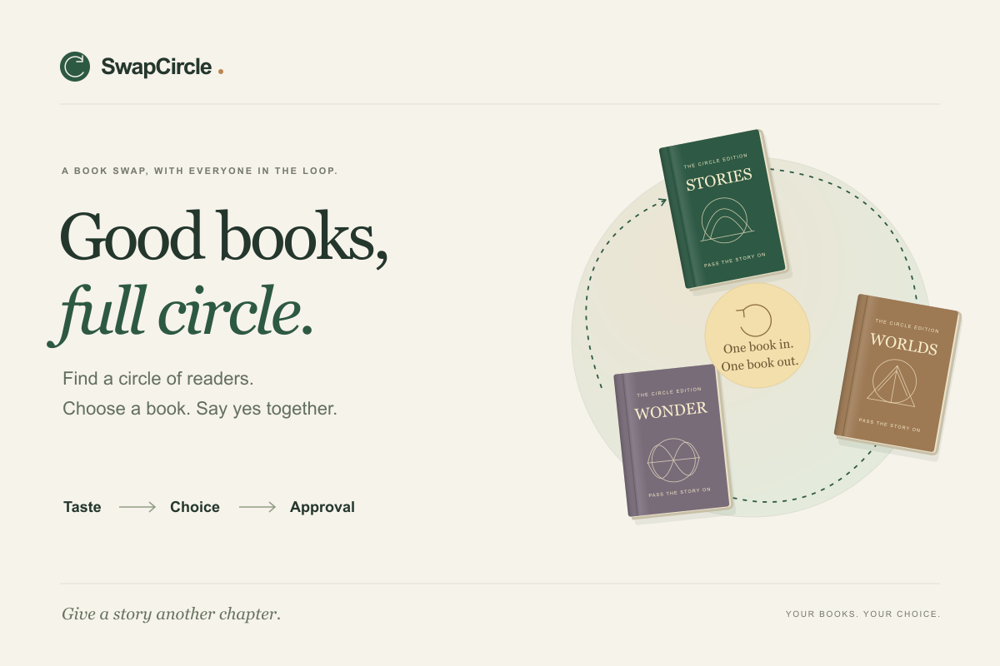

# SwapCircle

You want a neighbor's book. They want someone else's. A direct swap stops there, even when a circle of readers could each leave with a book they chose.

SwapCircle helps a small group discover those possibilities and agree on the exchange. Each reader offers one physical book and adds a few favorite films, artists or books. The implemented Qloo integration is designed to rank the other books on the table; genuine provider access remains unverified. Readers choose what they would read, the agent finds exchange circles, and everyone approves the exact book they will give and receive.

**Build status, October 30, 2026:** TypeScript checks, 88 automated tests and the production build passed. The HTTP/D1 smoke passed 107 assertions on each target: the development server, the local built Worker and the hosted app with Cloudflare D1. The app and MIT-licensed repository are public. The full 107-assertion hosted smoke also passed without sign-in. Live Qloo verification is pending an issued key. The sample uses authored rankings and simulated choices. It is not a recorded Qloo run.

[Devpost entry](https://devpost.com/software/swapcircle-f2lmq5) · [Hosted app](https://swapcircle-books.abhinav-0905.chatgpt.site) · [Narrated walkthrough](https://swapcircle-books.abhinav-0905.chatgpt.site/walkthrough) · [Source](https://github.com/Abhinav0905/swapcircle)



## Try the sample

Open the public app or run it locally, then choose **Try a sample circle**. The six-reader story moves through **2 → 6 → 2 → 5 matched readers**:

1. Iris and Sam can swap. Four other readers have not closed a circle.
2. Noor reviews one suggested book and chooses **I'd read this**. Six readers now have a proposed exchange, while direct swaps still cover two.
3. After the simulated approvals, Noor steps out. Her circle loses its approvals; Iris and Sam's approved pair stays intact.
4. Leo answers the repair question. A new three-person circle brings the total to five, with fresh approvals required for that changed circle.

Follow the [exact walkthrough](docs/DEMO.md). These counts prove behavior on an authored scenario. They do not measure reader satisfaction or a gain from Qloo.

## Where Qloo fits

Qloo's intended role comes before the want list. A reader might recognize none of the available books but know the films and music they love. With valid access and successful responses, typed search would resolve those favorites, then a single Insights request would rank only the other available books for that reader.

The agent uses that evidence to suggest a useful unanswered reading question. A positive answer can make a new circle possible. The reader can pass.

The [2-minute illustrated video](https://swapcircle-books.abhinav-0905.chatgpt.site/walkthrough) uses captured responses from the public sample, synthetic narration and English captions. It is not a screen recording or a live Qloo run. Its [Remotion source and reproduction instructions](video/README.md) are included in this repository.

Taste evidence, reading choice and exchange approval are separate records. An affinity score cannot grant permission. Missing Qloo results stay unknown, raw scores are not compared across readers, and a live error never becomes a sample response. The current provider does not turn undocumented explainability fields into personal reasons.

Multi-party trading and taste-based swapping have predecessors. [TradeMaximizer](https://github.com/chrisokasaki/TradeMaximizer) works from explicit want lists; [TasteSwap](https://devpost.com/software/tastemate-ygufsc) proposed Qloo-based item matching in 2025. This project's focus is discovery among actual offered books, a targeted next question and approval that survives only an unchanged exchange. See [research and scope](docs/RESEARCH.md).

## Run locally

Use Node.js 22.13.0 or newer and npm. The checked-in lockfile and scripts support a native macOS, Windows or Linux checkout. The default development port is 5173.

Install the locked dependencies, then build once to generate the local Worker configuration:

```sh
npm run install:ci
npm run build
```

On a fresh local database, apply the checked-in SQL once:

```sh
node --import ./scripts/sites-env.mjs ./node_modules/wrangler/bin/wrangler.js d1 execute DB --local --config dist/server/wrangler.json --persist-to .wrangler/state --file drizzle/0000_noisy_sabretooth.sql
```

This command changes only local D1 storage. Do not replay it after the tables already exist. Keep the persistence path at `.wrangler/state`; Wrangler adds its own versioned subdirectories.

Start the development server:

```sh
npm run dev
```

Open the printed loopback URL, normally `http://localhost:5173`. For a local preview of the built Worker, use `npm start` and its printed URL. Neither command publishes the site. After a schema change, `npm run db:generate` creates the next SQL migration.

### Live Qloo configuration

The sample needs no key. For live search and ranking, copy `.env.example` to an untracked `.dev.vars` file and enter your organizer-issued key there:

```dotenv
QLOO_API_KEY=your-key-goes-here
QLOO_BASE_URL=https://hackathon.api.qloo.com
```

Restart the local server after changing these values. The Cloudflare development plugin reads `.dev.vars`; production uses Worker runtime secrets. Never put the key in browser code, `.openai/hosting.json`, a screenshot or a deployment archive. Local environment files are ignored by Git.

Only `https://hackathon.api.qloo.com` and `https://api.qloo.com` are accepted API origins. A configured key is not proof that the provider accepts it. Confirm typed search and a complete fresh ranking with the issued credential before describing the app as live Qloo.

Once the hosted app has its server-side key, run the real provider check:

```sh
node scripts/live-qloo-check.mjs https://swapcircle-books.abhinav-0905.chatgpt.site
```

This resolves three known books and three films, creates a disposable live room with synthetic readers, verifies inventory-constrained Qloo rankings and database persistence, then deletes the room. Ambiguous catalog identities stop the check. It records no reading choices or approvals. A successful run writes credential-free evidence to the ignored `outputs/qloo-live-check.json`; until that happens, live verification remains pending. The command fails clearly when Qloo is not configured.

## Code and checks

React components handle the interface. Provider access, exchange rules, orchestration, authorization and persistence live in separate classes under `lib/`. Cloudflare D1 stores room snapshots and request counters. The app uses TypeScript, React, Vinext, Drizzle and Cloudflare Workers.

```sh
npm run verify
```

`verify` runs TypeScript checks, the test suite and the production build. The 88-test checkpoint covers provider contracts, exchange constraints, exact approvals, revisions, access rules and HTTP/MCP behavior. The solver is checked against a separate oracle on 120 seeded graphs and repairs.

With a local server running, exercise the actual HTTP routes and local D1 storage:

```sh
npm run smoke -- http://127.0.0.1:5173
```

Both the development-server run and the built-Worker run passed 107 assertions each. They checked separate member access, a concurrent revision race, the 2 → 6 → 2 → 5 repair sequence, MCP previews and cleanup of two disposable rooms per run. Both used fixture rankings and made no live Qloo calls. Local D1 success does not establish public deployment behavior.

The [GitHub Actions workflow](.github/workflows/verify.yml) runs locked installation, `verify` and a fresh local D1/built-Worker smoke on Node 22. [Run 41153316548](https://github.com/Abhinav0905/swapcircle/actions/runs/41153316548) passed all 88 tests and 107 HTTP/D1 assertions. A separate eight-case probe verifies request-body handling after an early rejection. Write requests are never retried. See the [verification record](docs/VERIFICATION.md) for the evidence boundaries.

- [Architecture and module responsibilities](docs/ARCHITECTURE.md)
- [HTTP routes and MCP contract](lib/server/README.md)
- [Qloo request contracts and limits](lib/qloo/README.md)
- [Reproducible sample](docs/DEMO.md)
- [Verification record](docs/VERIFICATION.md)

The application agent is a bounded workflow, with no in-app language model. External assistants can call four read-only tools at `/api/mcp`: `inspect_circle`, `suggest_next_question`, `explain_match` and `plan_exchanges`. A room capability is required. Tools preview stored evidence; they cannot approve a trade, contact a reader or move a book.

## Limits and access

Rooms support two to eight readers, one offered copy each and circles of two to four people. Live members receive separate private capability links. Anyone with a link can act as its reader; this is not identity verification. The host receives invitation links to distribute, so the software cannot prove that different people clicked each approval. Host role switching is reserved for labeled sample rooms.

Members report ownership, condition and availability. Qloo identifies the work, not a particular edition or physical copy. The app does not handle shipping, payments, reservations or completed handoffs. Room data remains in D1 until the host deletes it. Exported cards and invitation links need the same care as other private group information.

No reader pilot, completed real-world exchange, adoption, satisfaction improvement or environmental benefit has been measured. The next useful evidence is a live provider run followed by a small consenting group trying their own books.

Created during the Qloo Agentic Hackathon on October 30, 2026, with Codex assistance under Kumar Abhinav's direction. Project code is [MIT licensed](LICENSE); dependency and vendored notices retain their own terms.
