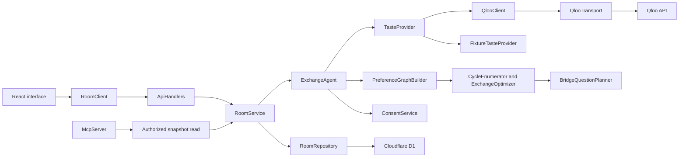

# SwapCircle architecture

SwapCircle separates cultural evidence, a person's reading choice and approval of an exact exchange. Each has its own record. A Qloo result can suggest a book, but it cannot create consent.

The app supports a room of two to eight members. Each member offers one physical copy. A proposed circle contains two to four members, and every member in that circle gives one book and receives one.



The constructor boundaries allow provider and persistence tests without network access. React components use ordinary function components. State transitions, storage, provider access and exchange rules live in separate classes.

| Module | Responsibility |
| --- | --- |
| `lib/domain/types.ts` | Shared room, book, evidence, choice, approval and action records. |
| `lib/domain/validation.ts` | Bounded input schemas and allowed entity categories. |
| `lib/client/RoomClient.ts` | Same-origin HTTP calls with a room capability. |
| `lib/client/AccessStore.ts` | Keeps persistent host invitations separate from each tab's active capability. |
| `lib/client/ExchangeExport.ts` | Source-labeled proposal and handoff text without credentials. |
| `lib/server/ApiHandlers.ts` | HTTP input checks, response mapping and request budgets. |
| `lib/server/HttpBoundary.ts` | Bounded JSON reads, origin checks, bearer parsing and safe errors. |
| `lib/server/RuntimeServices.ts` | Connects Worker secrets, D1, providers and services. |
| `lib/storage/CapabilityService.ts` | Generates room credentials and hashes them for storage. |
| `lib/storage/RoomService.ts` | Authorizes actions, checks revisions and saves state transitions. |
| `lib/storage/RoomRepository.ts` | D1 room snapshots, revision comparison and shared counters. |
| `lib/qloo/EntityResolver.ts` | Parses typed search results without selecting an ambiguous result automatically. |
| `lib/qloo/QlooClient.ts` | Resolves identities and ranks only the offered book pool. |
| `lib/qloo/QlooTransport.ts` | Server-side authentication, timeouts, response limits and bounded retries. |
| `lib/exchange/PreferenceGraphBuilder.ts` | Turns explicit yes choices with current evidence into directed edges. |
| `lib/exchange/CycleEnumerator.ts` | Enumerates each feasible directed circle once. |
| `lib/exchange/ExchangeOptimizer.ts` | Chooses disjoint circles under the stated objective. |
| `lib/exchange/BridgeQuestionPlanner.ts` | Finds an unreviewed book whose acceptance would improve the plan. |
| `lib/exchange/ConsentService.ts` | Checks exact-circle approvals and preserves valid approved circles. |
| `lib/agent/ExchangeAgent.ts` | Runs ranking, planning, questions, choices and repair. |
| `lib/demo/` | Explicit fixture data for a reproducible demonstration. |
| `lib/server/McpServer.ts` | Gives an external agent read-only access to an authorized room. |

**Qloo boundary.** Live search uses `/search` with a typed entity category. The reader selects a result. Live creation checks that book and seed IDs have UUID syntax. That check does not independently verify a physical copy, its condition or its ownership; members supply those facts.

Ranking uses `GET /v2/insights` with `filter.type=urn:entity:book`, `signal.interests.entities` and `filter.results.entities`. The final filter restricts the response to other available books in the room. Two physical copies may share a Qloo work identity, but each copy keeps a different offer ID.

Every ranking records its source, timestamp, seed identities, requested offers, returned positions, missing offers, warnings and request parameters. Returned items outside the requested identities are ignored. Missing results remain unknown. The app retains raw affinity only as provider metadata; optimization uses each person's returned order. Qloo documents that scores are normalized per query in its [affinity guide](https://github.com/qloo/docs-public/blob/main/docs/interpreting-affinity-scores.md).

Live and fixture providers implement the same interface, but are selected explicitly by room mode. Live rooms reject fixture evidence. A failed live refresh rejects the operation and preserves the previously saved room. The UI's configuration indicator reports whether a key and allowed origin are configured; a successful provider request is separate evidence of access.

The key stays on the server. The transport permits only the configured official Qloo origin, rejects redirects and limits response size to 1 MiB. It spaces requests and retries at most once for a rate-limit or upstream server response. Those application limits are not a statement about the organizer's quota.

**Exchange rule.** An edge `giver -> recipient` exists only when all of these conditions hold:

- Both members and the giver's physical offer are available.
- The recipient has exactly one explicit `yes` choice for that offer.
- Current evidence belongs to that recipient and the same taste seeds.
- The offer was requested, returned with the same entity identity and given a valid ordinal rank.
- The offer is not listed as missing.

Duplicate or contradictory choices cannot create an edge. Declines remain excluded. A book owned by the recipient cannot become a self-swap.

`CycleEnumerator` walks directed paths of length two to four. The smallest member ID anchors each circle so rotated copies are not counted twice. `ExchangeOptimizer` enumerates disjoint partitions of at most eight members. It handles the first free member by either leaving them unmatched or selecting a feasible circle containing them.

The objective is lexicographic:

1. Match the most available members.
2. During repair, change the fewest remaining members' incoming-book assignments.
3. Minimize the worst within-person rank.
4. Minimize the sum of ordinal ranks.
5. Break ties by stable circle fingerprints.

Fully approved circles that remain feasible are fixed before this optimization. That protection can limit total coverage; it is intentional. The direct-swap comparison solves the same eligible graph using only two-person circles. `directSwapCount` is the number of matched people, which makes it comparable with `matchedCount`.

**The next question.** When some members remain unmatched, `BridgeQuestionPlanner` temporarily adds one unreviewed, evidence-backed choice at a time. It asks about a book only if the additional edge would increase the matched count while preserving protected circles. It prefers greater coverage, fewer changed assignments, a better ordinal rank and then stable IDs. This computation does not record a yes. A prior no is never repackaged as a new question.

**Approval and repair.** The fingerprint contains the complete ordered set of giver, recipient and physical-book IDs. It is a lossless identity, not a shortened hash. An approval must refer to the member's current proposed fingerprint. A stale or unrelated fingerprint is rejected.

A withdrawal makes the member and offer unavailable. The agent rebuilds the plan, clears approvals belonging to changed circles and preserves exact unaffected approved circles. Rejoining does not restore erased approvals. A changed book or taste profile clears all rankings, reading choices, plans and approvals so new evidence can be collected.

**Capabilities and storage.** Each room receives one host capability and one member capability per reader. Tokens contain 32 random bytes. D1 stores their SHA-256 digests. The create response returns plaintext invitation tokens once; ordinary reads never return credentials.

Possession of a member link authorizes that member's actions. This is not verified identity. The creating host initially receives the member links to distribute and can retain them, so the system cannot prove that independent people clicked each approval. Share links privately. In live mode, the host token itself can rank, plan and delete, but cannot make a member's reading choices or approve their trade. Demo hosts may simulate responses, with visible labels.

The host capability and invitation map are saved together in local storage. Each browser tab saves its current capability in session storage. Opening a member link in another tab does not replace the host's saved access or erase invitations. A member's reload keeps that tab's role. After closing a member tab, use the original private invitation to return. Malformed saved JSON is ignored. If browser storage is blocked, the current page keeps access in memory and retains its credential fragment in the URL.

The client sends the current room revision with each action. `RoomService` checks it before execution, and `RoomRepository.save` performs a database update conditioned on the same revision. If another request saved first, the later write fails with HTTP 409. This second check protects against a change that arrives while Qloo is responding. A stale ranking request may have used provider calls, but its result cannot overwrite newer room state.

Room data remains in D1 until the host deletes the room. Deletion removes the room and its credential digests, which disables its links. Request counters are stored separately. They use an IP digest rather than a stored raw IP address; this is not a claim of anonymous usage.

Exports first read the current authorized room from the server, then generate the text from that returned revision. A failed refresh prevents the download. An export remains a dated snapshot, and a later change can invalidate it.

**HTTP and agent tools.** Browser calls are restricted to the same origin. Server clients can omit the Origin header. Protected operations require an Authorization bearer token. JSON bodies are limited to 48,000 bytes. Responses use private, no-store headers and do not expose arbitrary provider error text or stack traces.

| Endpoint | Operation |
| --- | --- |
| `GET /api/status` | Returns configuration presence, without secret values. |
| `GET /api/search?q=...&type=...` | Performs a bounded live entity search. |
| `POST /api/rooms` | Creates a demo or live room and its invitation capabilities. |
| `GET /api/rooms/:id` | Reads a room with one of its capabilities. |
| `POST /api/rooms/:id` | Applies an authorized action at the stated revision. |
| `DELETE /api/rooms/:id` | Deletes a room using its host capability. |
| `POST /api/mcp` | Serves the stateless JSON MCP interface. |

MCP exposes `inspect_circle`, `suggest_next_question`, `explain_match` and `plan_exchanges`. Calls require the same room capability. These tools read stored evidence and compute previews. They do not fetch new Qloo data, persist changes, approve exchanges or contact members.

**Verification boundary.** The exchange tests compare the solver with a separate subset-and-permutation oracle on 120 seeded graphs and their repairs. Storage tests use an in-memory repository with revision comparison to check role enforcement, stale writes, invitation hashes, deletion and invalidation. These tests establish code behavior. They do not establish a successful deployed D1 transaction, browser accessibility or live Qloo quality; those need their own recorded checks.

On October 30, 2026, TypeScript checks, the full 78-test suite and the production build passed. Separate runs of `scripts/smoke.mjs` passed 107 assertions each against the development server and the built Worker, with local D1 storage. They checked a real concurrent revision race, separate capabilities and the repair sequence. Both used fixture rankings. The same 107 assertions also passed against the hosted Worker and Cloudflare D1, including an anonymous run after public release. A genuine Qloo run remains pending. See [verification status](VERIFICATION.md).

Run the focused suites with:

```sh
npx tsx --test tests/exchange.test.ts tests/storage.test.ts
```
