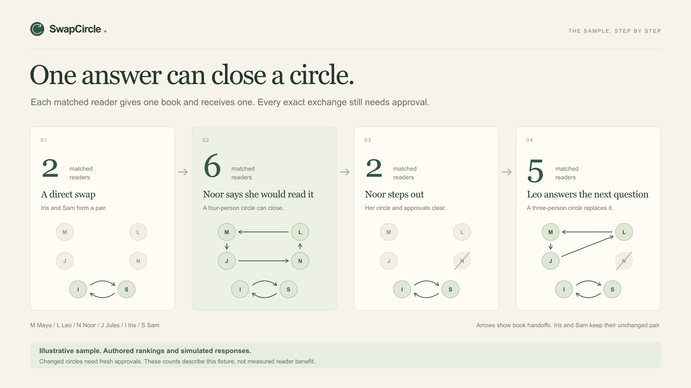

# Reproduce the sample exchange

This scenario uses six fictional readers, authored ranking orders and simulated responses. It makes no Qloo requests. The sequence below was run through the actual `RoomService` and `ExchangeAgent`, with an in-memory repository, on October 30, 2026. Its counts are covered by `tests/storage.test.ts`.

The same progression also passed a 107-assertion HTTP/D1 smoke on each local target: the development server and the built Worker. Both runs used separate member capabilities for choices and approvals, then deleted their two disposable rooms. They still used fixture taste evidence. See the [verification record](VERIFICATION.md).

Start the application with the setup in the repository README, then choose **Try a sample circle**. Each new sample room starts from the same choices. If suggestions are not loaded yet, select **Find taste matches**.

| Reader | Book offered |
| --- | --- |
| Maya | The Left Hand of Darkness, Ursula K. Le Guin |
| Leo | The Overstory, Richard Powers |
| Noor | Piranesi, Susanna Clarke |
| Jules | A Psalm for the Wild-Built, Becky Chambers |
| Iris | Braiding Sweetgrass, Robin Wall Kimmerer |
| Sam | The Dispossessed, Ursula K. Le Guin |

The sample has five recorded reading choices: Maya would read Leo's book, Leo would read Noor's, Jules would read Maya's, Iris would read Sam's and Sam would read Iris's. These are authored demonstration choices. A real room starts with no such responses.

1. **Inspect the starting plan.** Iris and Sam can swap directly. The table shows **2 readers in direct swaps** and **2 readers with exchange circles**. The other four do not yet form a closed loop.

2. **Open Noor's panel.** The next question asks Noor to consider Jules's *A Psalm for the Wild-Built*. It is number 2 in Noor's authored ranking. Select **I'd read this** for that book. This is a simulated reading choice, not a simulated approval yet.

3. **Inspect the result.** The plan now covers **6 readers**, while direct swaps still cover **2**. Iris and Sam keep their pair. The other circle is:

   ```text
   Jules gives A Psalm for the Wild-Built to Noor.
   Noor gives Piranesi to Leo.
   Leo gives The Overstory to Maya.
   Maya gives The Left Hand of Darkness to Jules.
   ```

4. **Approve the exact exchanges.** Select each reader in turn and choose **Simulate approval**. Each panel states the book that reader gives and receives. After all six have approved, the export control becomes **Handoff cards**. The downloaded text still says its approvals are simulated.

5. **Make a realistic change.** Open Noor's panel and select **Simulate Noor stepping out**. Noor's book becomes unavailable. The four-person circle disappears and its approvals are cleared. Iris and Sam's unchanged, approved pair remains. The count returns to **2 matched readers**.

6. **Answer the repair question.** The next question now asks Leo to consider Jules's *A Psalm for the Wild-Built*. Select **I'd read this** for Leo. The plan covers **5 available readers**, compared with **2 in direct swaps**. Its new three-person circle is:

   ```text
   Jules gives A Psalm for the Wild-Built to Leo.
   Leo gives The Overstory to Maya.
   Maya gives The Left Hand of Darkness to Jules.
   ```

7. **Check approvals before exporting.** Iris and Sam retain their two exact approvals. Jules, Leo and Maya must approve the revised circle. Their earlier approvals do not carry over. Noor remains outside the plan.

| Stage | Direct-only matched people | Matched people with circles | Approvals retained |
| --- | ---: | ---: | --- |
| Initial rankings | 2 | 2 | None |
| Noor accepts the suggested book | 2 | 6 | None |
| All six simulate approval | 2 | 6 | All six |
| Noor withdraws | 2 | 2 | Iris and Sam |
| Leo accepts the repair book | 2 | 5 | Iris and Sam |

Use **Taste evidence** to inspect the source for each reader. Every source should say `Fixture`. The reader panel's evidence details include the seeds, requested pool, timestamp and warning about authored data. **Agent activity** records ranking, planning, the next question, choices, approvals and withdrawal.

To test a refusal, create another sample room and choose **Pass** on Noor's proposed book. The agent may find a different unreviewed possibility. It must not repeat that declined book as a bridge or treat the pass as acceptance. If no remaining question can close a circle, unmatched readers keep their books.

To test separate access, use **Invite readers** and open a member's private link in another browser profile. A member capability can change only that reader's choices and approvals. It cannot run the host's ranking action or delete the room. Demo links still represent fictional participants, even when opened separately.

You can also test host and member links in separate tabs of the same browser. Reload both: each tab should keep its own role, and the host should still have all invitation links. The active member capability is saved for that tab; retain the original private link for a later visit after the tab is closed.

The host receives invitation links when creating a room. Anyone who holds a member link can act for that member, so this is a capability test, not proof of a person's identity. The host token and member token have different permissions.

Run the automated reproduction without a browser:

```sh
npx tsx --test tests/storage.test.ts
```

Look for the test named `authored demo reproduces 2 to 6 matches and a consent-safe 5-person repair`. The suite also checks stale revisions, concurrent writes, exact approval fingerprints and changed-book invalidation. It uses test storage and does not call Qloo.

For a live demonstration, configure a valid organizer-issued key, create a new live room, resolve the offered books and cultural favorites, then fetch fresh rankings. Preserve the returned source labels and missing results. Use the actual returned graph, even if it yields fewer exchanges than this sample. A configured key alone does not establish live access, and this sample does not establish that real readers will enjoy their books or agree to trade.

## Illustrated walkthrough



This is an explanatory graphic, not an application screenshot or live Qloo result.
